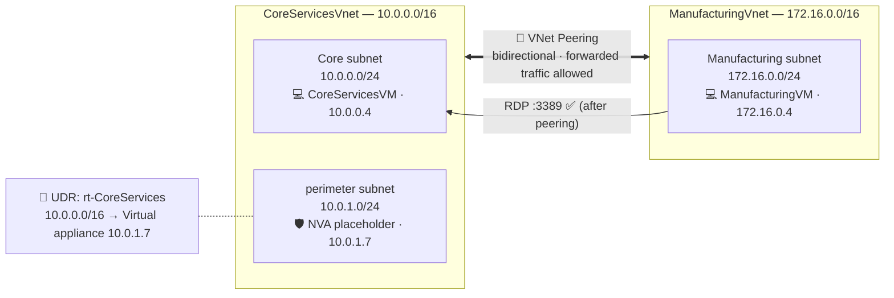

# 🌐 Azure Intersite Connectivity — VNet Peering, Network Watcher & Custom Routing


A hands-on Azure networking project: take two **isolated virtual networks**, prove they can't communicate, connect them with **VNet peering**, verify the connection, and then insert a **custom route** that forces traffic through a virtual appliance (the perimeter/NVA pattern) — with every step tested, not just configured.

---

## 📌 The scenario

> An organization segments its core IT services (DNS, security) from other departments, including manufacturing. Some scenarios genuinely need the two sides to communicate. The goal: enable that **deliberately and under control**, and set up a path for inspecting the traffic that crosses the boundary.

---

## 🏗️ Architecture



| Resource | Address space | Role |
|---|---|---|
| `CoreServicesVnet` | `10.0.0.0/16` | Core IT services |
| `Core` subnet | `10.0.0.0/24` | Hosts `CoreServicesVM` |
| `perimeter` subnet | `10.0.1.0/24` | DMZ-style subnet for a traffic-inspecting NVA |
| `ManufacturingVnet` | `172.16.0.0/16` | Manufacturing systems |
| `Manufacturing` subnet | `172.16.0.0/24` | Hosts `ManufacturingVM` |

---

## 🧩 What was built & tested — 6 tasks

| # | Task | What was done | Result |
|---|---|---|---|
| 1 | Create a VM in a VNet | `CoreServicesVM` (Windows Server 2025 Datacenter) in a new `CoreServicesVnet`, no public inbound ports | ✅ Deployed |
| 2 | Create a VM in a *different* VNet | `ManufacturingVM` in a new `ManufacturingVnet` (`172.16.0.0/16`) | ✅ Deployed |
| 3 | Test connectivity **before** peering | **Network Watcher → Connection troubleshoot**, TCP 3389 | ❌ **Unreachable** (316/316 probes failed) |
| 4 | Configure VNet peering | Two peering links, both with forwarded traffic allowed | ✅ **Connected**, Fully Synchronized |
| 5 | Test connectivity **after** peering | Enabled the RDP firewall rule via Run Command, then `Test-NetConnection 10.0.0.4 -port 3389` | ✅ **`TcpTestSucceeded : True`** |
| 6 | Create a custom route | Added `perimeter` subnet, route table `rt-CoreServices`, route `PerimetertoCore` → virtual appliance `10.0.1.7` | ✅ Associated with the perimeter subnet |

### The before/after proof (Tasks 3 → 5)

**Before peering** — Network Watcher:
```
Connectivity test          : Unreachable   (probes sent: 316, failed: 316)
Outbound NSG diagnostic    : Deny          (CoreServicesVM-nsg)
Inbound NSG diagnostic     : Deny          (ManufacturingVM-nsg)
Next hop (from source)     : None          (System Route)
```

**After peering** — PowerShell from `ManufacturingVM`:
```
ComputerName     : 10.0.0.4
RemoteAddress    : 10.0.0.4
RemotePort       : 3389
SourceAddress    : 172.16.0.4
TcpTestSucceeded : True
```

The test only means something because Task 3 proved it failed first. That before/after structure is deliberate.

### The custom route (Task 6)

| Field | Value |
|---|---|
| Route table | `rt-CoreServices` |
| Route name | `PerimetertoCore` |
| Destination | `10.0.0.0/16` |
| Next hop type | Virtual appliance |
| Next hop address | `10.0.1.7` |
| Associated subnet | `perimeter` |

Traffic from the perimeter subnet bound for the core network is forced through an inspection point instead of taking Azure's default direct route. `10.0.1.7` is a placeholder; no appliance was actually deployed there (see [`docs/custom-routes-and-nva.md`](docs/custom-routes-and-nva.md)).

---

## 📁 Repository Structure

```
azure-intersite-connectivity-lab/
├── README.md
├── .gitignore
├── scripts/
│   ├── 01-create-vms-and-vnets.sh
│   ├── 02-test-connectivity-before-peering.sh
│   ├── 03-create-vnet-peering.sh
│   ├── 04-enable-rdp-and-test-connection.sh
│   ├── 05-create-perimeter-and-custom-route.sh
│   └── cleanup.sh / .ps1
└── docs/
    ├── architecture.md                  # Design reasoning
    ├── network-watcher-diagnostics.md    # How to read the diagnostic output
    ├── custom-routes-and-nva.md           # UDR + NVA pattern explained
    └── screenshots/                        # 35 real portal/shell screenshots, in lab order
```

---

## 🚀 Try it yourself

### Prerequisites
- An Azure subscription
- [Azure CLI](https://learn.microsoft.com/cli/azure/install-azure-cli) (`az login`)

### Run the full sequence
```bash
cd scripts
chmod +x *.sh

./01-create-vms-and-vnets.sh
./02-test-connectivity-before-peering.sh   # expect: Unreachable
./03-create-vnet-peering.sh
./04-enable-rdp-and-test-connection.sh     # expect: TcpTestSucceeded True
./05-create-perimeter-and-custom-route.sh
```

> ⚠️ **Cost note:** this creates two Windows Server VMs. Run the cleanup script when you're done.

### Clean up
```bash
./cleanup.sh
```

---

## 📸 Lab Walkthrough (real screenshots)

| # | Step | Screenshot |
|---|---|---|
| 1 | Lab introduction & scenario | `01-lab-intro.png` |
| 2 | Architecture diagram from the lab guide | `02-architecture-diagram-and-tasks.png` |
| 3 | Full list of tasks | `03-job-skills-full-list.png` |
| 4 | Task 1: create `CoreServicesVM` | `04-task1-create-coreservicesvm-basics.png` |
| 5 | Task 1: public inbound ports = None | `05-task1-public-inbound-none.png` |
| 6 | Task 1: review + create | `06-task1-review-create.png` |
| 7 | Task 1: `CoreServicesVM` deployed | `07-task1-coreservicesvm-deployed.png` |
| 8 | Task 2: `ManufacturingVnet` config | `08-task2-manufacturingvnet-config.png` |
| 9 | Task 2: `ManufacturingVM` deployed | `09-task2-manufacturingvm-deployed.png` |
| 10 | Task 3: Network Watcher | `10-task3-network-watcher-start.png` |
| 11 | Task 3: connection troubleshoot settings | `11-task3-connection-troubleshoot-settings.png` |
| 12 | Task 3: **Unreachable** before peering | `12-task3-result-unreachable-before-peering.png` |
| 13 | Task 4: `CoreServicesVnet` peerings | `13-task4-coreservicesvnet-peerings.png` |
| 14 | Task 4: add peering (Manufacturing side) | `14-task4-add-peering-manufacturing-side.png` |
| 15 | Task 4: add peering (Core side) | `15-task4-add-peering-core-side.png` |
| 16 | Task 4: peering **Connected** (Core) | `16-task4-peering-connected-coreservices.png` |
| 17 | Task 4: peering **Connected** (Manufacturing) | `17-task4-peering-connected-manufacturing.png` |
| 18 | Task 5: `CoreServicesVM` private IP | `18-task5-coreservicesvm-private-ip.png` |
| 19 | Task 5: Run Command menu | `19-task5-run-command-menu.png` |
| 20 | Task 5: enabling RDP firewall rule (running) | `20-task5-enable-rdp-firewall-running.png` |
| 21 | Task 5: enabling RDP firewall rule (complete) | `21-task5-enable-rdp-firewall-complete.png` |
| 22 | Task 5: `ManufacturingVM` overview | `22-task5-manufacturingvm-overview.png` |
| 23 | Task 5: `ManufacturingVM` Run Command | `23-task5-manufacturingvm-run-command-menu.png` |
| 24 | Task 5: `Test-NetConnection` running | `24-task5-test-netconnection-running.png` |
| 25 | Task 5: **`TcpTestSucceeded: True`** | `25-task5-test-netconnection-success.png` |
| 26 | Task 6: virtual networks list | `26-task6-add-perimeter-subnet.png` |
| 27 | Task 6: perimeter subnet form | `27-task6-perimeter-subnet-form.png` |
| 28 | Task 6: perimeter subnet added | `28-task6-perimeter-subnet-added.png` |
| 29 | Task 6: route tables (empty) | `29-task6-route-tables-empty.png` |
| 30 | Task 6: route table deployed | `30-task6-route-table-deployed.png` |
| 31 | Task 6: add route (blank) | `31-task6-add-route-form-blank.png` |
| 32 | Task 6: add route (filled in) | `32-task6-add-route-filled.png` |
| 33 | Task 6: associate with perimeter subnet | `33-task6-associate-subnet.png` |
| 34 | Cleanup: Cloud Shell | `34-cleanup-cloudshell-start.png` |
| 35 | Cleanup: `Remove-AzResourceGroup` | `35-cleanup-remove-resourcegroup.png` |

*(All in `docs/screenshots/`. GitHub renders them directly.)*

---

## 🧠 What this project demonstrates
- Designing **segmented networks** with non-overlapping address spaces (`10.0.0.0/16` and `172.16.0.0/16`)
- **Network Watcher** as a layered diagnostic tool (routing, NSG rules, reachability), not just a pass/fail check
- **Bidirectional VNet peering**, including why **"allow forwarded traffic"** matters for NVA scenarios
- Validating a fix with a **before/after test**, not assuming it worked
- **User Defined Routes** and the perimeter/NVA inspection pattern
- Using **Run Command** and `Test-NetConnection` to test connectivity without exposing RDP to the internet
- Full lifecycle: build → test failure → fix → test success → extend → clean up

---

## 📄 License
This project is for learning purposes and documents a personal Azure training lab.
